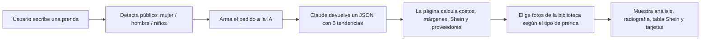

# Cómo funciona

## Flujo general

1. **Búsqueda.** El usuario escribe una prenda y, si quiere, una marca. Si el texto incluye "mujer", "dama", "hombre", "varón", "niños", etc., el selector de público cambia solo.
2. **Pedido a la IA.** La página arma un pedido (*prompt*) con la prenda, el público, la marca, el mes, el dólar y la forma exacta del JSON que necesita.
3. **Respuesta.** Claude devuelve un JSON con el resumen, el veredicto, la radiografía y **5 variantes**. Cada variante trae puntajes por plataforma, fuentes, colores, precios, proveedores, filtros, categoría de foto y cómo presentarla.
4. **Cálculos.** La IA no calcula costos: la página hace todas las cuentas con los **supuestos de importación** que elige el usuario. Así los números son coherentes y cambian al instante si se cambia el dólar o los impuestos.
5. **Fotos.** Cada tendencia trae una `foto_categoria`, por ejemplo `camisa_m`, y la página toma 2 fotos de esa categoría de la biblioteca. Si la IA no la indica, la deduce por palabras clave. Si una categoría no tiene fotos, usa una parecida, por ejemplo sweater en lugar de chaleco. Si el usuario pega una foto propia, esa tiene prioridad.
6. **Prenda del mes.** El primer día de cada mes, la IA elige una prenda y la página la guarda para que todos vean la misma. No repite prendas de meses anteriores.

## Qué le pedimos a la IA

En cada búsqueda, la IA recibe:

- su **rol**: analista de tendencias de moda y e-commerce que ayuda a un importador uruguayo;
- el **contexto**: mes actual, estación en Uruguay, dólar, público y marca;
- la **tarea**: las 5 variantes con más tracción en TikTok, Instagram, Pinterest y Amazon;
- para cada variante:
  - precio en origen y en Uruguay, con `null` si no llegó;
  - precio en Shein;
  - dónde se ve la tendencia, con la búsqueda exacta;
  - de 4 a 6 proveedores, con precio, pedido mínimo y demora;
  - los 3 filtros cualitativos (tendencia, Uruguay, hueco);
  - la categoría de foto;
  - fondo y accesorios para la foto, copy y gancho;
- la **radiografía**: cortes, estilos, colores y telas, con estado;
- las **reglas**: son estimaciones, no inventar tiendas locales concretas, frases cortas, responder solo con JSON.

El texto completo de los pedidos está en `index.html`, en las funciones `prompt(q, marca)` (búsqueda) y `promptMes(prev)` (prenda del mes).

Si la respuesta viene incompleta o con errores (colores mal escritos, campos faltantes, plataformas con otro nombre), la página igual funciona: valida cada campo y usa valores por defecto.

## Fórmulas

Todas se recalculan al cambiar los **Supuestos de importación**.

| Cálculo | Fórmula |
|---|---|
| Precio en origen | promedio entre el mínimo y el máximo que estima la IA |
| **Puesta en Uruguay (courier)** | (precio en origen + envío por prenda) × (1 + impuestos %) × dólar |
| **Margen** | (precio de venta en Uruguay − costo puesto) ÷ precio de venta |
| Precio sugerido (si no llegó a Uruguay) | costo puesto × 2, que equivale a un margen del 50 % |
| **Shein al cliente** | (precio Shein + envío Shein) × 1,22 (IVA) × dólar |
| Diferencia con Shein | tu precio ÷ Shein al cliente |
| Veredicto Shein | ≤ 1,3 → *Le ganás* · ≤ 2,5 → *Parejo: ganás por rapidez y talle* · > 2,5 → *Shein es mucho más barato* |

### Dónde traerla: costo puesto según cómo entra la mercadería

| Vía | Proveedores | Fórmula (por prenda) |
|---|---|---|
| Courier | AliExpress, Shein, Temu, Amazon | (precio + envío) × (1 + impuestos %) |
| Importación formal | Alibaba, 1688 | (precio + flete) × (1 + 70 %) |
| Mercosur | Mayoristas de Brasil | (precio + flete) × (1 + 30 %) |
| Sin importar | Mayoristas en Uruguay | precio |

El resultado se multiplica por el dólar. **Más barato** marca el menor costo puesto, sin contar Shein, que es solo referencia. **Para probar** marca la opción más barata con pedido mínimo de hasta 3 unidades.

### Valores por defecto

| Supuesto | Valor | Por qué |
|---|---|---|
| Dólar | $ 40 | Cotización de referencia de 2026 |
| Envío courier por prenda | US$ 8 | Envío del paquete repartido entre las prendas |
| Régimen | Prestación única, 60 % | La franquicia es para uso personal, no para revender |
| IVA Shein | 22 % | Compras desde China por franquicia, desde mayo de 2026 |
| Envío Shein por prenda | US$ 2 | Estimado |
| Importación formal | flete US$ 1,5 + 70 % | **Estimado**: aranceles, tasas, IVA y despachante |
| Mercosur | flete US$ 2 + 30 % | **Estimado**: sin arancel con certificado de origen |

## Dónde se guardan los datos

| Dato | Dentro de Claude | Fuera de Claude |
|---|---|---|
| Fotos que pega el usuario | Almacenamiento de archivos del artifact + base `fotos` | `localStorage` (achicadas a 640 px) |
| Prenda del mes e historial | Base `destacado` (una por mes, compartida) | `localStorage` |
| Biblioteca de fotos | Base `biblioteca` | `data/biblioteca.js` + `img/biblioteca/` |
| Supuestos, búsquedas recientes, clave de API | `localStorage` del navegador | `localStorage` del navegador |

## Decisiones de diseño

- **Un solo archivo**: fácil de entregar, de abrir y de publicar.
- **Paleta**: blanco con detalles en azul y verde oliva. El verde oliva marca lo que hace el usuario (fotos, cómo venderla, dónde traerla) y el azul marca la información (números, dónde se vio).
- **Cuadrantes**: cada tendencia separa fotos, números, fuentes, venta y proveedores para que se lea rápido en la demo.
- **Transparencia**: todo lo estimado lo dice en pantalla y trae un enlace para verificarlo.
